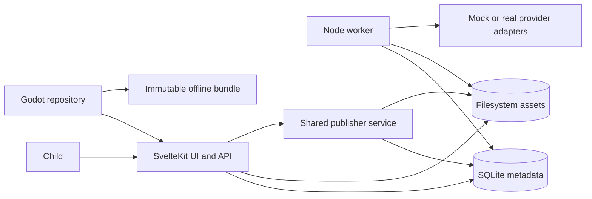

# 01 — System architecture

## Purpose
Define deployable processes, trust boundaries, ownership, and data flow.

## Scope
Local studio, worker, SQLite, filesystem storage, publisher, Godot client, and optional external AI adapters. No separate backend server or mandatory cloud service.

## Technical approach
Run SvelteKit with adapter-node and a separate Node worker sharing one local SQLite database and storage root. Use WAL, foreign keys, busy timeout, short transactions, and one worker initially. Studio requests enqueue work and return immediately. Browser never receives provider secrets or direct storage paths.

## Architecture and responsibilities
- `studio`: input validation, UI, content APIs, enqueue/cancel/retry requests, approval and explicit publication requests.
- `database`: migrations and repositories; domain services do not construct raw SQL in route handlers.
- `workflow`: persistent DAG/scheduling and transitions; worker owns execution and leases.
- `ai`, `image-processing`, `animation`: interchangeable generation, deterministic processing, and sheet construction respectively.
- `contracts`: public content, request/response, stage and configuration schemas; no database dependency.
- `content-publisher`: snapshots, validation, release transactions and bundle export. Called by worker for publication and tools for fixture seeding/bundles; routes enqueue publication rather than copying files synchronously.
- `game`: validates content independently, loads textures, simulates gameplay; never writes authoring database.

Storage is `originals/` (immutable source bytes), `generated/` (attempt outputs), `approved/` (frozen review snapshots), `published/` (immutable revisions and release snapshots). DB resides under ignored `storage/db/`. Serve only whitelisted files through server routes. Original metadata may contain private information; only derived game assets enter releases.

## Key design decisions
SQLite is authoritative for authoring and active development release ID; immutable JSON manifests are authoritative within each offline bundle. API and offline repository return identical validated content DTOs. Poll release ETag in development, not per-frame HTTP. Atomic publication uses filesystem staging followed by DB activation; see plan 09 for crash recovery. Draft changes invalidate previous approval.

Bind local services to loopback by default. Before LAN/hosted deployment, require authenticated guardian/admin access, authorization on mutations and private assets, CSRF/origin checks, HTTPS, rate limits and storage quotas. Local-first does not justify arbitrary cross-origin mutation access. Use configured roots and generated IDs, never client-supplied filesystem paths.

## Dependencies
Plans 04, 05, 08, 09 define contracts, transactions, scheduling and publication. Node/pnpm versions pinned in Phase 1. Real provider use waits until mock acceptance.

## Implementation tasks
- [ ] Add validated config for DB/storage, API base URL, provider routing and limits.
- [ ] Establish dependency graph and repository/service boundaries.
- [ ] Add request/job correlation IDs and structured logs without descriptions/images/secrets.
- [ ] Implement health endpoints and graceful worker shutdown.
- [ ] Document backup/restore of DB plus immutable files; never copy live WAL DB unsafely.

## Acceptance criteria
Studio and worker restart independently without losing jobs. Game can switch source without gameplay edits. No AI work blocks HTTP responses. No draft/private file is exposed by the public content API. Configuration errors fail early.

## Risks and limitations
Single-host SQLite is not a multi-region queue. Disk exhaustion, WAL contention, orphan files, and interrupted publication require explicit handling. Hashes detect corruption, not malicious content authenticity. A local initial deployment is not a secure public multi-user service.

## Future considerations
Object storage, authentication/multi-user access, signed bundles and distributed execution require separate decisions and migration plans; preserve contracts and repository boundaries.
