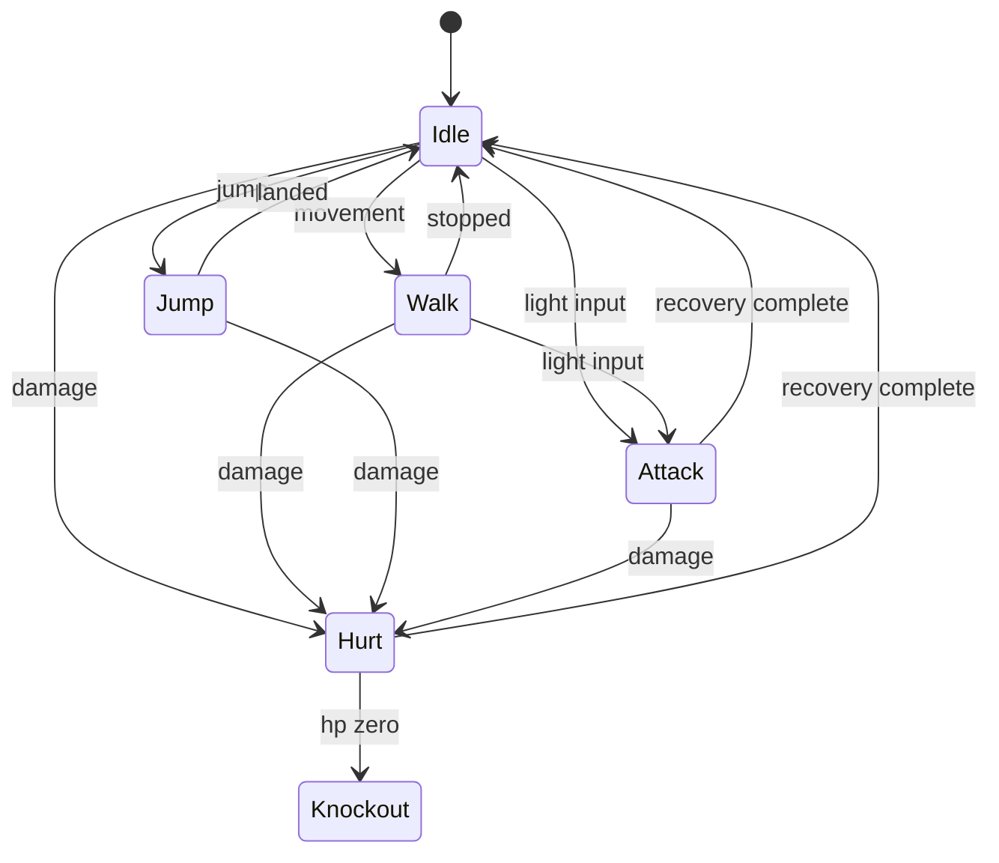

# 03 — Godot game architecture

## Purpose
Define a reusable, data-driven 2.5D beat-'em-up using Godot's 2D renderer.

## Scope
Prototype: movement on X/depth Y, jumping, light melee, health/hurt/knockback/knockout, enemies/waves, arena/camera/HUD, character selection. Architect extension points for projectiles, area/dash attacks, shields, summons and specials without implementing all mechanics initially.

## Technical approach
Pin **Godot 4.7.2-stable**, standard GDScript build, Compatibility renderer. The official [release archive](https://godotengine.org/download/archive/) lists 4.7.2 as stable and 4.8 as beta at planning review. Verify binary/export-template versions during Phase 1; any change requires a decision record. No C# runtime needed.

Reusable `Fighter.tscn` root is `CharacterBody2D` positioned at ground contact. Children: ground collision shape, `Shadow`, `VisualPivot/AnimatedSprite2D`, hurtbox/hitbox `Area2D` nodes, animation controller and health/combat components. Enable Y-sort on arena actor container. Keep root Y at ground plane; visual elevation translates pivot upward, never root into depth. Shadow remains at root and shrinks with jump height.

## Architecture and responsibilities
- `FighterController`: input intent (player or AI), ground velocity and arena limits; normalizes diagonal movement.
- `FighterStateMachine`: idle, walk, jump, attack, hurt, knockout; knockout terminal until respawn. Hurt interrupts attacks; attack blocks ordinary locomotion unless attack definition permits it.
- `AnimationController`: constructs/plays SpriteFrames, optional AnimationPlayer or deterministic state elapsed-time events for attack windows; gameplay timing must not depend on render FPS or art frame count.
- `CombatController`: attack instance IDs, cooldown, windows, target deduplication, team filtering, knockback and damage; no character-name branches.
- `HealthComponent`: clamp HP, damage signals, knockout once; HUD subscribes to signals.
- `EnemyBrain`: approach target's ground point, align depth, attack in range, recover; no AI embedded in visual resource.
- `WaveDirector`: spawn from definitions, cap active enemies, advance only after defeat.
- `CharacterFactory`: validated DTO -> reusable fighter stats/resources; selection menu asks repository, not filesystem.

All non-knockout states can transition directly to knockout on lethal damage; diagram abbreviates guards. Vertical jump integration uses elevation and vertical velocity in physics tick with gravity. Ground speed/depth bounds are distinct from elevation. Attacks use ground-plane range/depth overlap plus target elevation bounds; merely overlapping screen sprites is not a valid hit. Initial policy: ground light attack only, airborne targets outside its elevation range are missed. Hurtboxes mirror facing and track visual elevation where applicable.

## Key design decisions
Contract units are pixels, seconds, HP; see plan 04. Default art faces right, mirrored X for left (including anchor/hitbox offsets). Collision layers distinguish world, ground bodies, hurtboxes and hitboxes. A target receives at most one hit per attack instance unless explicitly modeled as multi-hit later. No arbitrary executable behavior in content. Unknown unsupported ability kinds fail package validation rather than executing scripts.

## Dependencies
Phase 2 fixture provides stats/animations. Prototype can load local fixture before API integration. Phase 4 repository/decoder supplies resources without changing fighter scene. Exact toolchain pin recorded in plan 13.

## Implementation tasks
- [ ] Build arena with Y-sorted actors, walls, camera and shadow.
- [ ] Add reusable fighter, input map, state transitions and jump integration.
- [ ] Implement melee timing, team filtering, HP/knockback/KO and deterministic combat tests.
- [ ] Add enemy behavior, waves, HUD and fixture-driven selection.
- [ ] Add headless scene runner and command-line fixture injection.

## Acceptance criteria
Two fighters using different fixture art move at defined speeds, sort correctly by depth, jump without moving their ground root, hit only within legal windows/depth/elevation, and enter KO exactly once. Enemy waves finish; no character-specific scene exists.

## Risks and limitations
Headless tests cannot establish visual feel; add manual playtest evidence. Art anchors and depth collision can look wrong despite valid JSON. Engine physics order and nondeterministic random choices must be controlled for tests.

## Future considerations
Implement additional ability executors, controller support, co-op and richer animation systems behind the same data interfaces. Skeletal animation is not needed for initial sprites.
