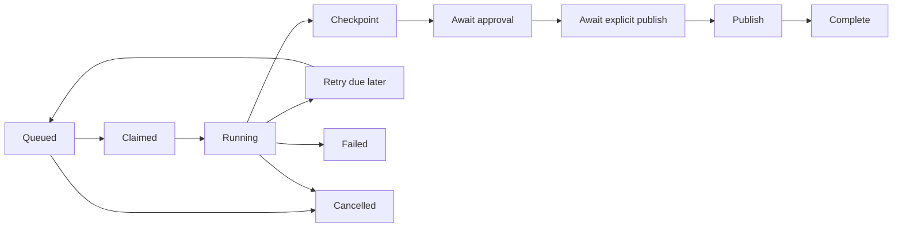

# 08 — Durable workflow engine

## Purpose
Specify reliable, independently restartable background execution without heavyweight orchestration infrastructure.

## Scope
Node/TypeScript worker, SQLite scheduling, stage DAG, typed checkpoints, retries, cancellation, cache invalidation and approval gates. No long-running jobs inside SvelteKit requests.

## Technical approach
Start one worker with configurable bounded concurrency (default one image stage at a time), polling SQLite every second. Jobs and steps have `queued`, `running`, `waiting_approval`, `waiting_publish`, `succeeded`, `failed`, `cancelled` states as appropriate; steps additionally permit `cached` and `blocked`. Define explicit transition functions, not scattered arbitrary status updates. Final generation job succeeds when review snapshot exists and approval/publish gates complete; user can leave it waiting indefinitely without holding resources. Explicit publication can use a linked `kind=publish` job referencing the approved snapshot, completing the parent gate only upon success.

## Architecture and responsibilities
`Stage<I,O>` declares key/version, input/output schemas, dependencies, cache policy and `execute(context,input): Promise<O>`. Context includes immutable attempt ID, logger, abort signal, storage accessor and provider adapter. Scheduler claims ready steps; executor invokes handler outside transaction; repository checks lease/fence before accepting outputs. Stage handlers never directly mutate scheduler state.

Claim within short `BEGIN IMMEDIATE` transaction: select eligible due step with all dependencies succeeded/cached, ensure job not cancelled, increment attempt and fencing token, set worker ID and lease expiry. Default lease 60 seconds, heartbeat every 15 seconds. A sweeper requeues expired leases with retry accounting. Completion update must match running status + lease token and unexpired lease; late workers cannot publish checkpoints. Graceful shutdown stops claims, aborts work where possible, and finishes/relinquishes leases safely.

## Key design decisions
- **At-least-once execution**, not exactly-once external billing. Use provider idempotency keys when supported; persist request IDs before polling. Ambiguous timeout with a provider lacking idempotency requires user/operator reconciliation before repeating paid calls.
- Cache key = SHA-256(canonical validated inputs + upstream content hashes + stage implementation version + provider/model version + parameters/seed). Cache hits require output files still exist and verify; no global cross-user cache assumption.
- Attempts write to distinct paths. Only fenced completion adopts outputs; stale attempt files are orphans, not selected assets. All publication side effects pass through idempotent publisher service.
- Default three attempts for transient I/O/429/5xx, exponential delays 2/4/8 seconds with bounded jitter and Retry-After support. Validation/unsupported capability/authentication errors fail immediately. Limits/delays configurable and recorded per job.
- Retry a failed branch with unchanged validated inputs; changed parameters create a new version/graph. Clear only downstream selected outputs, never delete immutable history. Manual retry respects budget and uses a new attempt record.
- Cancellation sets durable flag and signals running handlers; stop scheduling descendants. Provider requests may finish/bill despite abort. Completion after cancellation is not adopted. Cancellation after release activation cannot undo publication; a separate release rollback is required.
- Approval is append-only and hash-bound. Waiting jobs own no lease. A publication request checks latest approval and current frozen hash transactionally; old approval cannot authorize a regenerated version.

## Dependencies
Database leases/attempts/indexes (plan 05), stage DAG (07), provider interface (10), publication transaction (09). Phase 1 worker only has a lifecycle smoke test; real execution is Phase 6.

## Phase 6 foundation increment
`packages/workflow` now defines validated envelopes, generic typed stages, canonical input identities, graph enqueue and fenced execution/adoption. `packages/database` owns additive job/step/attempt persistence and short immediate transactions for claims, heartbeat, retry/failure, expiry recovery and cancellation (ADR-032). The reconciled worker runs the bounded polling/heartbeat/cancellation/shutdown scheduler for metadata analysis only (ADR-033/036). Attempt-scoped PNG storage and capture now verify produced files before fenced JSON adoption and reverify on reads (ADR-034). Offline mock analysis/cleanup/master factories now receive provider composition, consume adopted same-job/version/snapshot dependencies and record a resolved input identity including checkpoint hashes (ADR-035). Body, pose, raw-frame, normalization and sheet libraries now persist branch-addressed, attempt-scoped artifacts (ADRs 038–043); the mock does not condition frame pixels on the pose. A library-only manifest stage joins the five adopted sheets into a bounded, fenced metadata checkpoint without granting review or publication authority (ADR-045). A separate fenced validation stage rechecks selected manifest and sheet provenance and publisher-grade PNG bytes without freezing a review snapshot (ADR-046). Automatic cache reuse, job gates, manual retry and capture-first production handler registration remain unimplemented. Completed computation alone does not advertise a review snapshot or success of approval/publication gates.

## Implementation tasks
- [ ] Implement transition guards, claim/heartbeat/sweeper and fence-aware completion.
- [ ] Implement validated checkpoints, cache keys and dependency invalidation.
- [ ] Add retry classification/budget, cancel propagation and graceful termination.
- [ ] Add persisted approval/publication gates and job status API projections.
- [ ] Add fake clock/fault injection hooks for deterministic tests.

## Acceptance criteria
Kill/restart a worker mid-stage and the job resumes without accepting stale outputs. Two workers cannot adopt the same step completion. Transient failures retry to limit; permanent failures stop. Cancelled work cannot publish. Unchanged branches survive selective regeneration. Waiting approval consumes no active lease.

## Risks and limitations
Clock skew matters if processes move to separate hosts; initial same-host model avoids distributed lease clocks. SQLite queue contention is bounded by short transactions. Files/provider side effects cannot participate in SQLite rollback, so cleanup and idempotency are essential.

## Future considerations
Metrics for queue age/retries, fair scheduling and per-provider concurrency. Introduce more infrastructure only after measured limits and a recorded migration decision.
